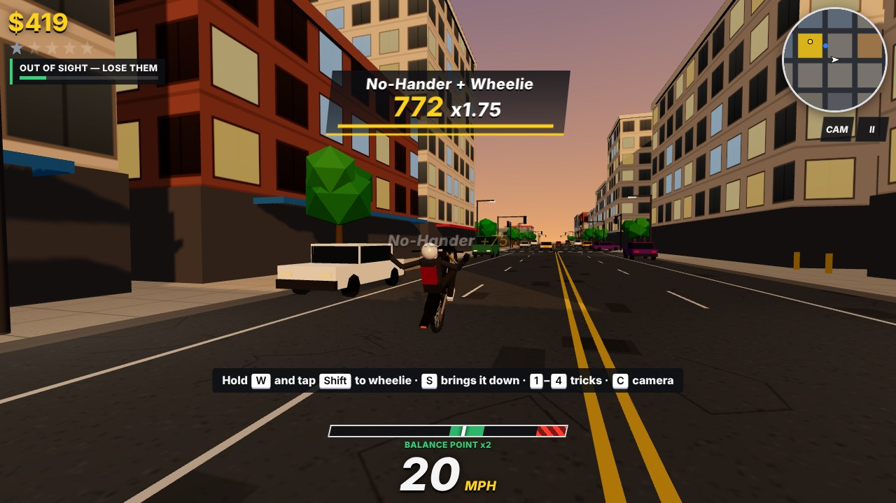

# Wheelie Works

A 3D bike-life game that runs in the browser. Ride wheelie bikes, e-bikes and e-motos
through a city, hold wheelies on the balance point, chain tricks into combos, slice
through traffic and outrun the cops. Built with [three.js](https://threejs.org/) — no
build step, no downloaded assets (models, textures and sound are all generated in code).



## Play

Any static file server works:

```bash
npm start            # python3 -m http.server 8080
# then open http://localhost:8080
```

To put it online, push the repo to GitHub and enable **Settings → Pages → Deploy from a
branch** (root folder). It is a plain static site.

The game detects what you are playing on and sets itself up:

| Device | Controls | UI |
| --- | --- | --- |
| PC | Keyboard (or gamepad) | Full HUD, high graphics |
| Tablet | Touch, larger buttons (1.3×) | Medium graphics |
| Phone | Touch, landscape | Compact HUD, lighter graphics |

It also switches live — touch the screen and the touch controls appear, press a key and
they go away. Everything can be overridden in **Settings**.

## Controls

| Action | Keyboard | Touch | Gamepad |
| --- | --- | --- | --- |
| Throttle | `W` / `↑` | GAS (slide up for more) | RT |
| Brake (rear brake in a wheelie) | `S` / `↓` | BRAKE | LT |
| Steer | `A` `D` / `←` `→` | Left stick | Left stick |
| Lean back (pull up) | `Shift` / `Q` | Stick down | Stick back |
| Lean forward | `E` | Stick up | Stick forward |
| Stoppie (hold) — normal braking never tips you over | `X` | STOPPIE | Right stick click |
| Bunny hop (hold, release) | `Space` | HOP | A |
| One-hander / no-hander / seat stander / foot drag (tap on, tap off) | `1` `2` `3` `4` (or `J` `K` `L` `;`) | Trick buttons | X / Y / B / LB |
| Burnout mode on/off (motor bikes): then hold throttle, steer to spin | `B` | BURNOUT | — |
| Camera (chase, far, first person, handlebar) | `C` | CAM | RB |
| Reset to the road (riding) / bring the bike to you (on foot) | `R` | RESET / CALL BIKE | Back |
| Get on the bike when standing next to it | `F` | GET ON | — |
| Full map and waypoints | `N` | tap the minimap | — |
| Pause, mute, time of day | `P`, `M`, `T` | II | Start |

**Your first wheelie:** get rolling, hold throttle and lean back. Feather the throttle to
float in the green balance-point zone; tap the brake if it goes too far. Stopped against a
wall? Hold brake to paddle backwards.

## What's in it

- **Physics** — the bike and rider are a rigid body on two sprung wheels with tyre forces
  at the contact patches. Wheelies, stoppies, loop-outs, squat, dive, kerb hits and jumps
  all come out of the simulation rather than being scripted. Four assist levels: *Easy*
  (auto-balance), *Normal* (shaped throttle, catches you at the balance point), *Semi-sim*
  (no catch, but it goes over slowly enough to save) and *Sim* (raw).
- **Nine bikes** — Wheelie Bike, Trail MTB, Santa Cruz V10 (full-suspension downhill), Macfox X1, Super73-RX, Surron Light Bee X,
  Talaria Sting R, E Ride Pro-SS and the Stark Varg, each with its own weight, geometry,
  power curve, balance point and temperament.
- **Tricks and combos** — wheelies, manuals, stoppies, hops, air, flips, swerves, skids,
  12 o'clock scrapes, traffic near-misses, plus four hold-to-pose variations that also work
  in the air (Superman, Can-Can…). Chain them before the timer runs out to bank cash.
- **City** — an 8×8-block island: downtown towers with alleys, a park with hills, a dirt
  jump park, a skate plaza, a construction site with container gaps, a civic plaza with
  stair sets, a concrete skate park (half-pipe, roll-in, funbox, quarter wall, spine) and
  the Wheelie Works shop. Traffic obeys lights; cars brake for you.
- **Cops** — patrols notice wheelies, speeding and e-motos. Five heat levels escalate from
  one cruiser to backup, roadblocks, bike cops that follow you through alleys, and a
  helicopter. Break line of sight and stay hidden to escape for a payout. Dawdle or walk
  near a cruiser and it pulls up short, an officer jumps out and runs you down.
- **Progression** — cash from combos, escapes, jobs, races and 25 challenges buys bikes
  and customisation. Progress saves in the browser.
- **Delivery jobs** — stop in an orange ring outside one of six restaurants and accept the
  prompt to pick up an order, then race the clock to the drop-off. Faster drops tip more, wheelies on the way
  add a bonus, crashes damage the order, and deliveries in a row build a streak.
- **Races and wheelie runs** — four checkpoint races (blue rings) and two 60-second
  longest-wheelie runs (pink rings), each with bronze, silver and gold targets.
- **Seasons** — each season hides a new set of collectibles around the city, off the map,
  with its own reward. Season 1 hides 20 Neon Sprockets; find them all for the Aurora
  helmet. Add a season in `src/seasons.js`.
- **Shops you ride to** — next to the spawn are the *Dealership* (buy and switch bikes)
  and the *Customs* garage, whose door rolls up as you arrive. Ride into the glowing ring.
- **Map** — tap the minimap (or press `N`) for the full map; tap it to drop waypoints,
  which get a route on the minimap and a light beacon in the world.
- **Customs** — a *Performance* tab with installable mods that build on each other
  (battery stages, controller, high-current tune, sprocket, weight reduction, brakes,
  tyres) plus a free suspension tune, and an *Appearance* tab with per-part paint from a
  colour picker, wraps, wheel LEDs, a flag pole and a name plate.
- **Helmet cases** — the Customs *Helmets* tab sells cases that drop one of 19 helmets:
  Common, Rare, Epic, Legendary and the super-rare Mythic Graffiti Original (0.5%), plus the
  Ghost Helmet, which has no rarity at all.
- **Day/night cycle and weather** — a 24-minute day (12 minutes of daylight, 12 of night)
  with sunrise and sunset, and weather that drifts between clear, cloudy, fog, rain,
  thunderstorms and storms: falling rain, darker skies, lightning and thunder, and wet
  roads with less grip. Settings can fix the time of day or keep the weather clear.
- **Camera and sound** — five camera modes (including a free-look *Move cam*:
  drag the view, or use a gamepad's right stick), synthesised audio.

## Code map

| File | What it does |
| --- | --- |
| `src/main.js` | Game states and the main loop |
| `src/physics.js` | Bike dynamics, collisions, crashes |
| `src/bikes.js` | Bike specs, prices, mods and the customisation catalogue — tune the game here |
| `src/bikeModel.js`, `src/rider.js` | Procedural bike meshes; IK-posed rider and ragdoll |
| `src/bikeGlb.js`, `assets/models/` | Detailed glTF bike models, cut into the same moving parts |
| `src/world/` | City generator, terrain/colliders, sky and lighting, day/night cycle and weather |
| `src/traffic.js`, `src/cops.js` | Traffic and police AI |
| `src/tricks.js`, `src/progress.js` | Scoring, save data, challenges |
| `src/helmets.js` | Helmet catalogue, case odds and the helmet model |
| `src/jobs.js`, `src/seasons.js` | Deliveries, races, wheelie runs; season collectibles and rewards |
| `src/input.js`, `src/ui/` | Keyboard/gamepad/touch input, HUD, menus, touch controls |
| `src/audio.js`, `src/effects.js`, `src/camera.js` | Sound, particles, cameras |

## Credits

The Stark Varg is drawn with "Stark Varg SM"
(https://sketchfab.com/3d-models/stark-varg-sm-bab4fe6d066342eeb96611f37c616311) by
Hari Yojuta (https://sketchfab.com/hariroosi30), licensed under CC-BY-4.0
(http://creativecommons.org/licenses/by/4.0/). It was simplified and re-textured at smaller
sizes for the browser; see `assets/models/stark-varg-LICENSE.txt`.

The Santa Cruz V10 is drawn with "Santa Cruz V10 Downhill Mountain Bicycle"
(https://sketchfab.com/3d-models/santa-cruz-v10-downhill-mountain-bicycle-65e16e9785de4a019e35f599e47c9ee6)
by Arsen Ismailov (https://sketchfab.com/fdgasd7), licensed under CC-BY-4.0, simplified for the
browser; see `assets/models/santa-cruz-v10-LICENSE.txt`.

The helmets use "Full Face MTB Helmet"
(https://sketchfab.com/3d-models/full-face-mtb-helmet-2b0bb690bbca4453b6d385e4ee0f3294) by
chett33 (https://sketchfab.com/chett33), licensed under CC-BY-4.0, simplified and re-painted per
helmet; its original paint job is the Mythic "Graffiti Original". See
`assets/models/helmet-LICENSE.txt`.

Bike and brand names belong to their respective owners; this is an unaffiliated fan
project. three.js is MIT licensed (see `vendor/THREE-LICENSE`).

## Roadmap

Planned, not built yet:

- **Online multiplayer** — needs a server; the game is currently static files.
- **Season pass** — a reward track on top of the seasons in `src/seasons.js`.

